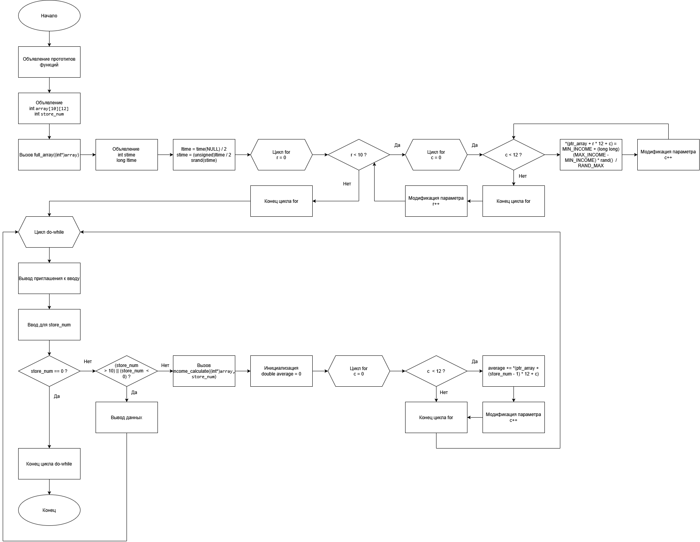

# Домашнее задание к работе 15

## Условие задачи
Фирма имеет 10 магазинов. Информация о доходе каждого магазина за каждый месяц года хранится в двумерном массиве (первого магазина — в первой строке, второго — во второй и т. д.). Составить программу для расчета среднемесячного дохода любого магазина.

## 1. Алгоритм и блок-схема

### Алгоритм
1. **Начало**
2. Объявление прототипов функций
3. Объявление
   - int `array[10][12]` - двумерный массив
   - int `store_num` - номер магазина
4. Вызов full_array((int*)`array`)
   - Функция заполняется массив случайными значениями
   - Принимает int `*(ptr_array)` - указатель на массив
   - Возвращает void
5. Начало цикла do-while с условием выхода из цикла `store_num` == 0
6. Вывод приглашения к вводу данных
8. Ввода данных для `store_num`
9. Условные оператор if-elif-else:
   - if: (`store_num` == 0) return 0;
   - else if: (`store_num` > 10 || store_num < 0) printf("Такого магазина нет\n\n");
   - else: printf("Среднемесячный доход %d магазина: %.2f\n\n", `store_num`, income_calculation((int*)`array`, `store_num`));
   - Функция income_calculation() рассчитывает среднемесячный доход любого магазина
   - Функция income_calculation() принимает int* `ptr_array`, int `store_num` - указатель на массив, номер магазина
   - Функция income_calculation() возвращает double `average / 12` - среднемесячный доход магазина
10. Конец do-while
11. **Конец**

### Блок-схема
 

## 2. Реализация программы

```
#define _CRT_SECURE_NO_WARNINGS
#define MIN_INCOME 400000
#define MAX_INCOME 600000
#include <stdio.h>
#include <locale.h>
#include <time.h>
#include <stdlib.h>
#include <limits.h>

void full_array(int* ptr_array);
double income_calculation(int* ptr_array, int store_num);

int main(void) {

	setlocale(LC_CTYPE, "RUS");

	int array[10][12];
	int store_num;

	full_array((int*)array);

	do {
		printf("Выберите магазин (0 - завершить программу): ");
		scanf("%d", &store_num);
		printf("\n");

		if (store_num == 0) return 0;
		else if (store_num > 10 || store_num < 0) printf("Такого магазина нет\n\n");
		else printf("Среднемесячный доход %d магазина: %.2f\n\n", store_num, income_calculation((int*)array, store_num));
	} 
	while (store_num != 0);

	return 0;
}

void full_array(int* ptr_array) {

	int stime;
	long ltime;

	ltime = time(NULL);
	stime = (unsigned)ltime / 2;
	srand(stime);

	for (int r = 0; r < 10; r++) {

		for (int c = 0; c < 12; c++) {

			*(ptr_array + r * 12 + c) = MIN_INCOME + (long long)(MAX_INCOME - MIN_INCOME)  * rand() / RAND_MAX;
		}
	}
}

double income_calculation(int* ptr_array, int store_num) {

	double average = 0;

	for (int c = 0; c < 12; c++) {
		average += *(ptr_array + (store_num - 1) * 12 + c);
	}

	return average / 12;
}
```

## 3. Результаты работы программы

```
Выберите магазин (0 - завершить программу): 10

Среднемесячный доход 10 магазина: 498604.08

Выберите магазин (0 - завершить программу): 1

Среднемесячный доход 1 магазина: 518048.58

Выберите магазин (0 - завершить программу): 7

Среднемесячный доход 7 магазина: 484806.42

Выберите магазин (0 - завершить программу): 4

Среднемесячный доход 4 магазина: 520611.67

Выберите магазин (0 - завершить программу): 3

Среднемесячный доход 3 магазина: 504424.75

Выберите магазин (0 - завершить программу): 3

Среднемесячный доход 3 магазина: 504424.75

Выберите магазин (0 - завершить программу): -20

Такого магазина нет

Выберите магазин (0 - завершить программу): 50

Такого магазина нет

Выберите магазин (0 - завершить программу): 0
```

## 4. Информация о разработчике

Лупачев Сергей бТИИ-262
